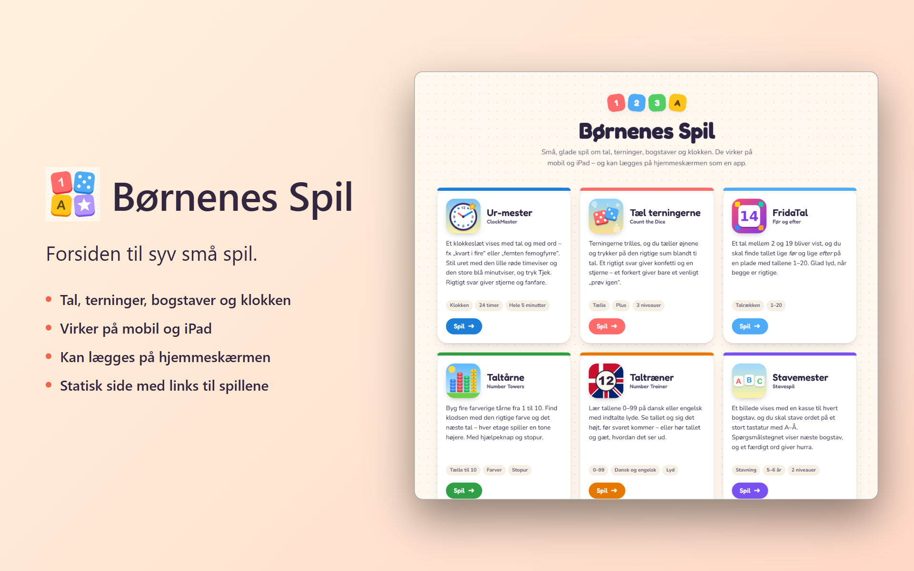

# KidsGames

**Forsiden til syv små spil.**

Statisk forside med links til spillene (`clockmaster/`, `countthedice/`, `fridatal/`, `numbertowers/`,
`numbertrainer/`, `stavemester/`, `whoisbiggest/`). Ingen build. Spillene ligger som undermapper af
KidsGames og deployes af deres egne repos.

- **FTP:** `webroots/www/kidsgames/` med spillene i `webroots/www/kidsgames/<spil>/`
- **GitHub Pages:** <https://kreaton.github.io/KidsGames/> med spillene i `/KidsGames/<spil>/`

## Deploy

**GitHub Actions:** `.github/workflows/deploy.yml` kører ved hvert push til `main` (eller manuelt
fra fanen Actions) og

- uploader `index.html` og `billeder/` til FTP. Den bruger repository secrets `FTP_HOST`,
  `FTP_USERNAME`, `FTP_PASSWORD` og `FTP_FOLDER` (`webroots/www/kidsgames`, uden `/` til sidst).
- lægger de samme filer i roden af branchen `gh-pages`, som GitHub Pages serverer.

Hvert spil bygger sig selv og lægger sig i sin egen mappe på FTP og i `gh-pages` (via deploy-nøglen
`PAGES_DEPLOY_KEY`). Opsætningen af secrets og deploy-nøgle laves én gang med
`_ToolsAndScripts/scripts/Setup-KidsGamesDeploy.ps1`.
