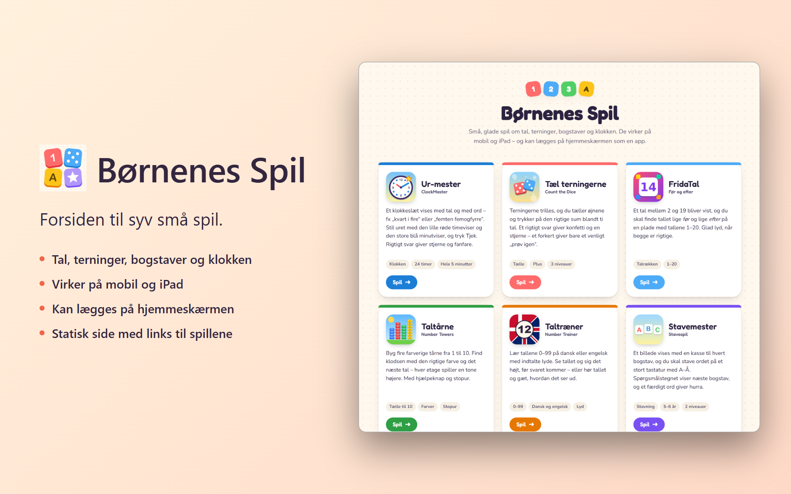

# KidsGames

⭐ Hvis KidsGames fortjener en plads på din maskine, så [giv det en stjerne på GitHub](https://github.com/kreaton/KidsGames) — det er gratis, lavet af én udvikler, og stjerner er det, der får andre til at finde det.

**Forsiden til fjorten små spil.**

Statisk forside med links til spillene (`axolotltables/`, `clockmaster/`, `clockmastereasy/`, `countthedice/`, `danskebyer/`, `easysolitaire/`, `fridatal/`, `huskemester/`, `kombimester/`, `languagefriends/`, `numbertowers/`,
`numbertrainer/`, `stavemester/`, `whoisbiggest/`). Ingen build. Spillene ligger som undermapper af
KidsGames og deployes af deres egne repos.

**GitHub Pages:** <https://kreaton.github.io/KidsGames/> med spillene i `/KidsGames/<spil>/`

## Deploy

**GitHub Actions:** `.github/workflows/deploy.yml` kører ved hvert push til `main` (eller manuelt
fra fanen Actions) og lægger `index.html` og `billeder/` i roden af branchen `gh-pages`, som
GitHub Pages serverer.

Hvert spil bygger sig selv og lægger sig i sin egen mappe i `gh-pages` (via deploy-nøglen
`PAGES_DEPLOY_KEY`). Opsætningen af deploy-nøglen laves én gang med
`_ToolsAndScripts/scripts/Setup-KidsGamesDeploy.ps1`.

## License & Authorship

This project is distributed under the terms of the [MIT License](LICENSE).

**AI authorship note:** Most of the source code in this repository was generated with AI coding agents (Claude Code), under my direction and review. Purely AI-generated material may not be eligible for copyright protection in some jurisdictions. To the extent any part of this project is protected by copyright, it is licensed under the MIT License, and the license's warranty and liability disclaimers apply to the project as a whole.

<!-- notices:start -->
### Independent development

KidsGames is an independent, personal project developed by Per Hejndorf. It is not affiliated with, endorsed by or sponsored by Microsoft or any other rights holder (including Google). Product names and logos are trademarks of their respective owners and are used only to identify the services and tools the project works with.

### Third-party notices and asset provenance

[THIRD-PARTY-NOTICES.md](THIRD-PARTY-NOTICES.md) lists every third-party library, font and online service the project uses, with version, licence, source and whether it was modified. It also records where the icons, images, audio and video came from and how they are licensed.
<!-- notices:end -->
